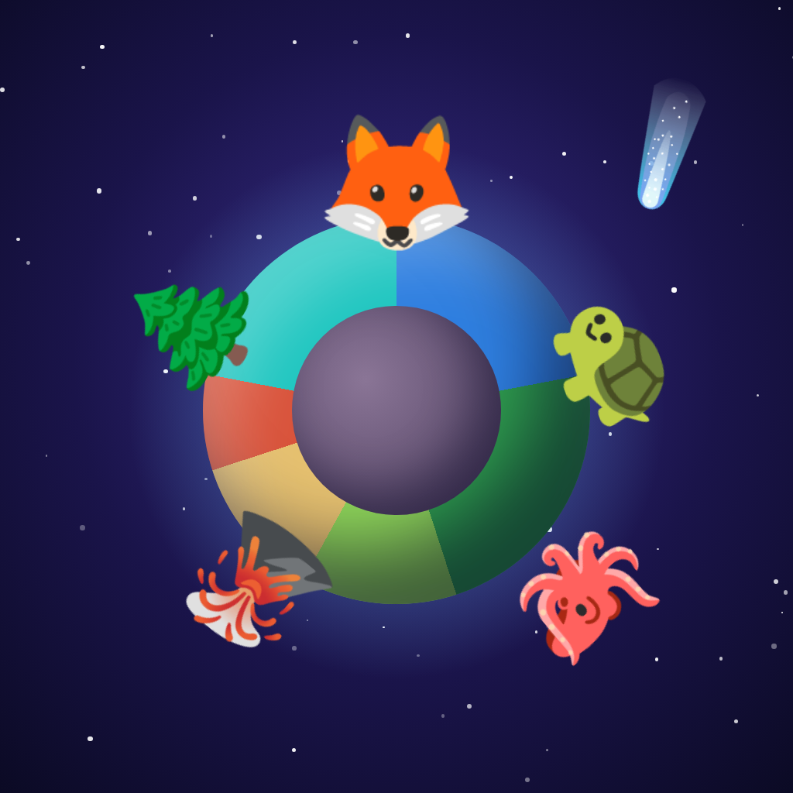

# Comet Garden

Fling rocks, ice comets, magma and seeds at a tiny spinning planet. Gravity bends each shot; the aim preview shows where it will land. Hits reshape the lands, and creatures move in when their habitat recipes fit. Fusions, Combos, sky obstacles and Troubles add ideas as the campaign teaches them.

<p align="center"></p>

The game has campaign chapters and chests, Bonus Remix chapters, a Lifebook, Wishes, the Cosmic Road, Star Calendar, monthly festivals and a themed seven-stop Weekly Voyage. Daily Planet, Meteor Rush, Zen Garden and Challenge a Friend all work without a server.

Your Homeworld grows through five levels. Build object Labs, a Greenhouse, Dens and a Launch Bay; invite friends, send expeditions, and complete permanent Landmarks. Earn and tune gameplay launchers through play. Friends have routines, and the Homeworld has seasons and decorative weather. Campaign wins fuel the Stardust Vault and speed construction. There are no lives, energy timers or paid timer skips.

Styles previews Keeper outfits, object effects, Homeworld looks and friend outfits. Paid looks change appearance only. Purchases, restore and outbound actions sit behind the parental gate in Grown-ups. There are no ads, loot boxes, tracking or random paid rewards. Accessibility includes Reduce Motion, larger text, a Clear planet palette, aim assistance and Gentle planets; the app supports English, Spanish, French, German, Portuguese and Japanese.

## Catalogue

Use [store/catalogue-sheet.md](store/catalogue-sheet.md) for the current 12 products, their permanent identifiers, prices, contents and Family Sharing settings. It is the product sheet for App Store Connect; the executable catalogue is `PRODUCTS` in `src/meta/tuning.ts`, checked against `ios/App/PocketPlanet.storekit` by tests.

The catalogue has four gem packs, the Piggy Bank, Starter Crew, the Cosmic Road pass, two themes, one planet pack and two style singles. The seven non-consumables grant fixed looks; the Road's paid lane grants cosmetics. Earned gems can buy looks and optional round helpers. A continue adds five throws for a flat 50 gems. The Vault has no paid doubling action, and Starter Crew has no automatic offer.

## Code and tools

TypeScript, Vite, Vitest and Canvas 2D, wrapped for iOS with Capacitor 8 and Swift Package Manager. Art in the game world is drawn in code. The app-local `PurchaseJournalPlugin.swift` owns StoreKit 2: transactions finish only after their profile grant is saved. `@capgo/native-purchases` remains installed pending the owner's dependency decision, but has no source imports and is excluded from the iOS package through `includePlugins`. Native plugins also cover Game Center, haptics, preferences, notifications, sharing, filesystem, review, splash and status bar.

```text
src/core/        pure world, round, flight, launcher and level rules
src/meta/        saves, rewards, purchases, Labs, Homeworld, Landmarks,
                 launcher selection, Roads, Wishes, cosmetics and tuning
src/ui/app.ts    navigation, round lifecycle and purchase reconciliation
src/ui/screens/  Play, Missions, Homeworld, Collection, Styles and their detail views
src/ui/flows/    pre-level, results, wishes, gate, checkout, settings and other sheets
src/ui/art/      procedural world, creatures, Keeper, launchers and cosmetic rendering
tests/           unit tests, save goldens, frozen level/rules fixtures and simulation gates
e2e/             browser journeys and visual/accessibility checks
store/           catalogue, submission copy, screenshots and preview
site/            static marketing, support and privacy pages
docs/            architecture, QA, handoff and product specifications
ios/             Xcode project and app-local native plugins
```

See [the architecture map](docs/handoff/03-architecture.md) for module responsibilities and [the roadmap](docs/product/ROADMAP-v2.md) for planned work.

```bash
npm install
npm run dev          # browser play; purchases use the mock store in dev
npm run typecheck
npm test
npm run format:check
npm run sim:quick
npm run ios:sync     # build and copy the web app into the native project
npm run ios:open
```

CI runs formatting, typecheck, tests, web build, simulation gates, browser journeys and native builds. Its `PocketPlanet-Simulator` artifact keeps its historical filename; the displayed app name is Comet Garden. On a Mac with Xcode, unzip that artifact and install it:

```bash
open -a Simulator
xcrun simctl install booted App.app
xcrun simctl launch booted com.pocketplanet.game
```

Purchase testing uses the shared Xcode scheme's StoreKit configuration; TestFlight uses the Apple sandbox.

## Shipping to the App Store

Follow [the iOS release checklist](docs/qa/release.md) and [the store package](store/README.md). The registered bundle ID remains `com.pocketplanet.game`; the app is iPhone-only with minimum iOS 15.4.

The owner configures signing, agreements, tax, banking, Game Center and App Store Connect, creating IAPs from the current catalogue sheet. From a clean working tree, `npm run ios:release` builds and syncs, checks the native bundle for development hooks, bumps the build number and prints the archive command. Verify native purchases, restore, Game Center, localization and Photos; inspect the archive privacy report and upload current store assets. Complete the adult TestFlight soak before submission and manual release.
